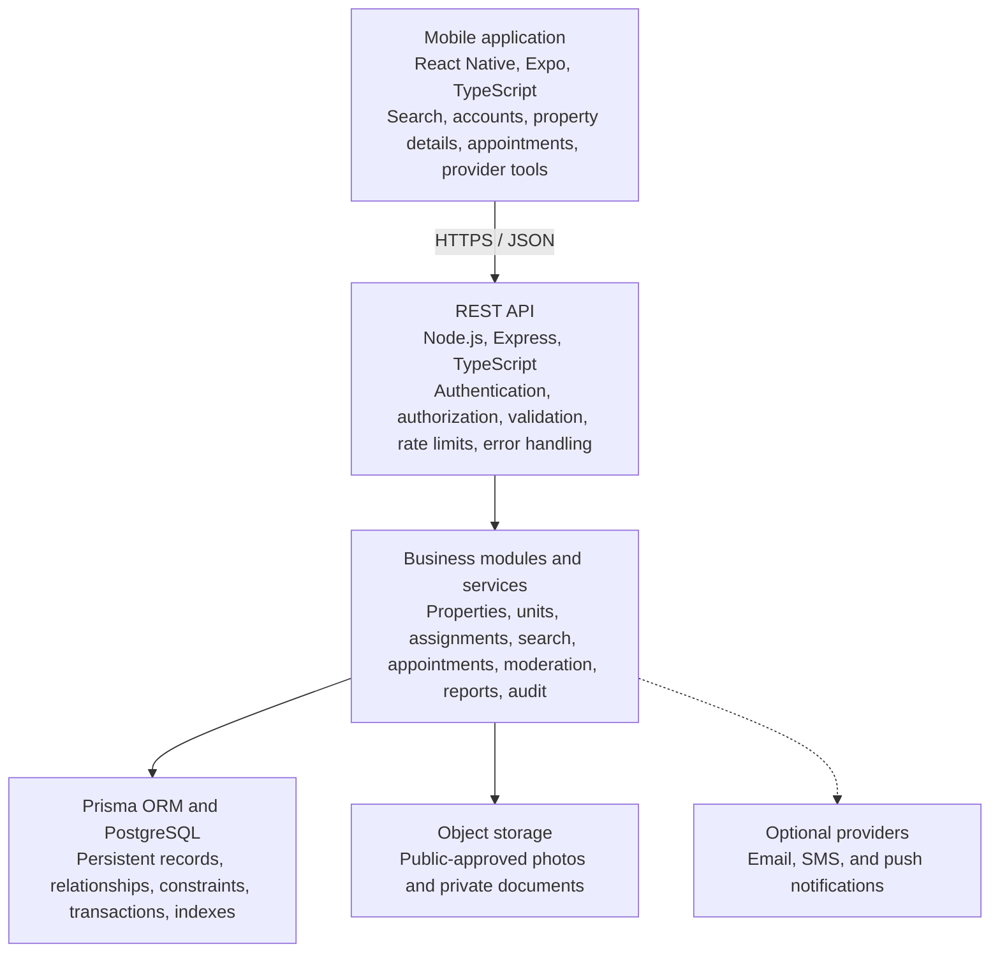
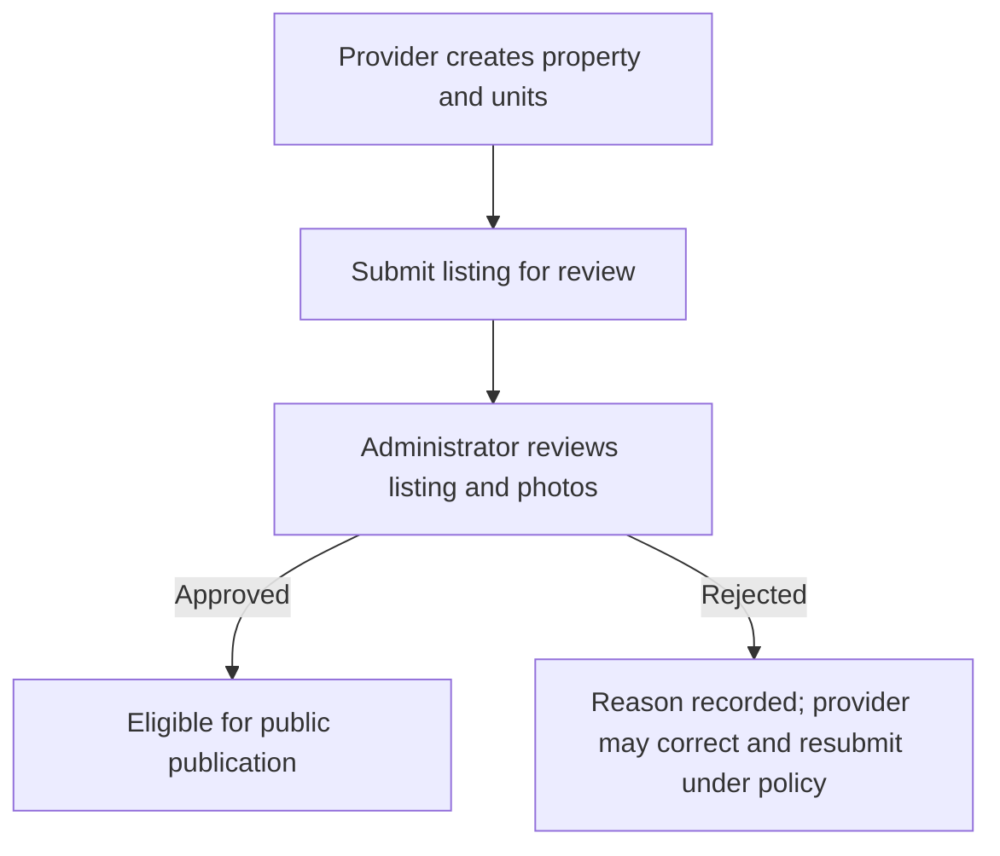

# NyumbaLink: High-Level Design (HLD)

| | |
|---|---|
| Version | 1.0 (updated baseline) |
| Date | 14 October 2026 |
| System type | Mobile-first rental platform |
| Target market | Kenya |

## 1. Introduction

### 1.1 Purpose

This document describes the high-level architecture of NyumbaLink, a mobile-first application designed to connect people searching for rental houses with landlords, caretakers, and authorized property agents in Kenya.

It defines the system's objectives, scope, users, architecture, major modules, external interfaces, security requirements, deployment model, risks, and implementation phases.

The document provides a shared reference for development, testing, project supervision, and future maintenance.

### 1.2 Background and problem statement

Finding rental housing can require searching across multiple sources, contacting different property providers, verifying whether listings are still available, and arranging physical visits through informal communication.

These processes can create several challenges:

- Difficulty filtering houses by location, house type, and rental budget.
- Incomplete or misleading listing information.
- Uncertainty about whether a provider is authorized to manage a property.
- Difficulty coordinating physical house-viewing appointments.
- Poor visibility into appointment status and changes.
- Limited mechanisms for reporting suspicious listings.
- Risk of unauthorized users changing property information.

NyumbaLink aims to centralize rental discovery and viewing coordination while introducing controlled provider access, listing moderation, and auditable administrative workflows.

### 1.3 Project objectives

The system shall:

1. Allow house seekers to discover rental properties using structured search and filters.
2. Display property details, photographs, locations, unit information, and monthly rent in Kenyan shillings.
3. Allow seekers to save favourites and request physical house viewings.
4. Enable landlords, caretakers, and agents to manage only the properties and units they are authorized to manage.
5. Provide provider verification and listing moderation workflows.
6. Prevent conflicting confirmed viewing appointments for the same rental unit.
7. Allow users to report suspicious listings.
8. Protect personal information and private verification documents.
9. Maintain auditable records of important security and administrative actions.
10. Provide a maintainable foundation for future enhancements, including optional AI-assisted search.

### 1.4 Scope

**In scope**

- Mobile application for Android and iOS using React Native and Expo.
- User registration, authentication, and account management.
- Role-based access control.
- Kenyan location-based property discovery.
- Property and individual rental-unit management.
- Provider assignments and verification.
- Listing submission, review, publication, and rejection.
- Property-image management.
- Favourites.
- Physical viewing appointments.
- Listing reports and administrative review.
- In-app notifications.
- Audit events and operational logging.
- Automated testing, documentation, and deployment preparation.

**Out of scope for the initial release**

- Rent payments, deposits, escrow, and financial transactions.
- Subscription and commission billing.
- A guaranteed external identity-verification service.
- AI-dependent property discovery.
- Native mobile applications implemented separately from Expo.
- A guarantee that free hosting plans will support production traffic indefinitely.

## 2. System users and roles

NyumbaLink has five primary roles.

| Role | Description |
|---|---|
| House Seeker | Searches for houses, views details, saves favourites, requests viewings, and reports suspicious listings. |
| Landlord | Manages properties and rental units they own or are authorized to manage. |
| Caretaker | Performs assigned property-management and viewing-coordination activities. |
| Agent | Manages properties and units within active, authorized assignments. |
| Administrator | Verifies providers, moderates listings, investigates reports, and reviews authorized audit records. |

Permissions must be enforced by the backend. A user must not be able to grant themselves a privileged role or access another provider's property simply by modifying an API request.

A caretaker or agent whose assignment is revoked must immediately lose the permissions that depend on that assignment.

## 3. System architecture

### 3.1 Architectural approach

NyumbaLink will use a modular monolith for the initial backend.

A modular monolith is one deployable backend application divided into well-defined functional modules. It is appropriate for a beginner-friendly project because it avoids the additional operational complexity of microservices while preserving clear boundaries between features.

The mobile application communicates with the backend through a versioned REST API. The backend validates requests, enforces permissions, applies business rules, and accesses PostgreSQL through Prisma.

Property images and private verification documents are stored in suitable object storage rather than being exposed directly from the database.

### 3.2 Technology stack

| Layer | Technology | Responsibility |
|---|---|---|
| Mobile | React Native | Cross-platform user interface |
| Mobile framework | Expo | Development, device APIs, builds, and app tooling |
| Language | TypeScript | Type safety and maintainability |
| Navigation | Expo Router | Screen routing and navigation |
| Server-state management | TanStack Query | API fetching, caching, and mutations |
| Forms | React Hook Form and Zod | Form state and validation |
| Backend runtime | Node.js | Server execution |
| API framework | Express | REST endpoints and middleware |
| Backend language | TypeScript | Backend types and contracts |
| ORM | Prisma | Database access and migrations |
| Database | PostgreSQL | Persistent relational data |
| Validation | Zod | Request and configuration validation |
| Testing | Compatible unit and integration testing framework | Automated verification |
| Media | Object storage adapter | Property images and private documents |
| Documentation | Markdown and Mermaid | HLD, LLD, diagrams, and development guides |

Additional dependencies should be introduced only when required. Package compatibility must be checked against the selected Expo SDK and installed Node.js version.

### 3.3 Logical architecture diagram

### 3.4 Request processing

A typical request follows this sequence:

1. A user performs an action in the mobile application.
2. The mobile application sends a request to the REST API.
3. Middleware identifies the authenticated user and applies relevant rate limits.
4. Zod validates the request data.
5. The controller invokes the appropriate service.
6. The service checks roles, ownership, assignments, and business rules.
7. Prisma accesses PostgreSQL.
8. The service returns a controlled result to the controller.
9. The API sends a documented response DTO.
10. The mobile application updates its screen and displays an appropriate status.

Sensitive operations must not rely exclusively on client-side checks.

## 4. Major system modules

### 4.1 Authentication and user management

Responsibilities:

- User registration and login.
- Password hashing and verification.
- Access-token and refresh-session management.
- Logout and session revocation.
- Password recovery where the necessary delivery provider is configured.
- Profile management.
- Account suspension and status checks.

The authentication design must specify token lifetime, refresh behavior, revocation, and secure mobile storage before implementation.

### 4.2 Provider management and verification

Responsibilities:

- Provider profile creation.
- Verification submission.
- Verification status tracking.
- Administrative review and decision recording.
- Provider suspension or reinstatement where authorized.

A provider cannot approve their own verification. Verification evidence must remain private.

### 4.3 Property and rental-unit management

A Property represents a building, compound, or physical property. A PropertyUnit represents a specific rentable space within that property.

For example, an apartment building may contain five units with different rental prices and availability. The building information is stored once, while each unit maintains its own details.

Property and unit management includes:

- Creating and editing permitted records.
- Maintaining structured location information.
- Managing rent and unit availability.
- Uploading listing photographs.
- Submitting listings for moderation.
- Archiving records while preserving required history.

### 4.4 Location and search

The search module supports:

- County.
- Town.
- Neighbourhood where data is available.
- House type.
- Minimum and maximum rent.
- Bedroom and bathroom filters where applicable.
- Unit availability.
- Pagination and sorting.

Search filtering and pagination should occur in PostgreSQL rather than loading all listings into application memory.

Public search must exclude unpublished listings and must return only information intended for public viewing.

### 4.5 Provider assignment management

A property assignment defines which provider can manage which property and within what scope.

This module supports:

- Creating assignments through authorized workflows.
- Recording the assigning actor.
- Checking active assignments.
- Revoking assignments.
- Auditing assignment changes.

Every protected provider operation must verify that the user has an active assignment and the correct scope.

### 4.6 Favourites

House seekers can save and remove properties or units from a personal favourites list. The system must prevent duplicate favourites and restrict access to the user's own records.

The implementation must select whether favourites target a whole property, an individual unit, or both, and use a database design that enforces the choice.

### 4.7 Viewing appointments

The appointment module supports:

- Viewing requests.
- Provider confirmation or decline.
- Rescheduling proposals.
- Cancellation.
- Completion and no-show records.
- Appointment history.
- Notifications and audit events.

A viewing appointment is not a rental contract and does not automatically reserve or rent a unit.

The system must prevent overlapping confirmed viewing appointments for the same unit, including simultaneous requests.

### 4.8 Listing reports and moderation

Users can report suspicious or inaccurate listings. Administrators can investigate reports, record decisions, and perform authorized moderation actions.

Reports must be treated as claims requiring investigation, not as proof of misconduct.

### 4.9 Notifications

The initial system should support persistent in-app notifications for relevant events, such as:

- Viewing requested.
- Viewing confirmed or declined.
- Rescheduling proposed.
- Viewing cancelled.
- Listing approved or rejected.
- Provider verification completed.

External email, SMS, and push delivery are optional integrations and must not be represented as operational until configured and tested.

### 4.10 Audit and operational logging

Audit events record significant actions such as provider verification, listing publication, assignment changes, appointment confirmation, and report resolution.

Operational logs support debugging and monitoring. Neither audit metadata nor ordinary logs should contain passwords, raw tokens, or private document contents.

## 5. Core business workflows

### 5.1 Listing publication workflow

The backend controls all status transitions. A provider cannot publish a listing by supplying PUBLISHED in a request body.

### 5.2 Property discovery workflow

1. The seeker opens the discovery screen.
2. The app requests available filters or location choices where necessary.
3. The seeker submits filters.
4. The API validates filters and executes a database query.
5. The API returns a paginated set of eligible public listings.
6. The seeker opens a property and inspects available units and photos.
7. The seeker may save a favourite or request a viewing.

If there are no results, the app should show a helpful empty state and allow the user to change filters.

### 5.3 Viewing workflow

1. The seeker selects a unit and proposes a time range.
2. The API validates the requested interval and eligibility.
3. The appointment is stored with status REQUESTED.
4. The authorized provider receives an in-app notification.
5. The provider confirms, declines, or proposes another time.
6. A confirmation is committed only if no conflicting confirmed appointment exists.
7. The system records the outcome and creates appropriate audit and notification records.
8. The appointment may later be cancelled, completed, or marked as a no-show according to the permitted workflow.

### 5.4 Listing-report workflow

1. A user submits a report and reason.
2. The API validates and rate-limits the request.
3. The report enters an open review queue.
4. An administrator investigates the listing and relevant history.
5. The administrator records a resolution and any permitted moderation action.
6. The system records an audit event.

## 6. Security and privacy architecture

NyumbaLink must implement security at the server, database, and storage boundaries.

### 6.1 Authentication

- Use secure password hashing.
- Validate authentication requests.
- Rate-limit login and recovery endpoints.
- Revoke sessions when appropriate.
- Protect mobile credentials using suitable secure storage.
- Redact credentials from logs.

### 6.2 Authorization

- Enforce roles on the server.
- Verify property ownership or active assignments.
- Protect administrative endpoints.
- Restrict users to records they are permitted to access.
- Prevent users from changing their own privileged roles.
- Re-check authorization on each sensitive operation.

### 6.3 Data protection

- Collect only necessary personal information.
- Separate public property photographs from private verification documents.
- Use private storage and authorized, short-lived access for sensitive files.
- Define retention and deletion policies.
- Avoid exposing private contact details unnecessarily.
- Review applicable Kenyan data-protection requirements before production deployment.

### 6.4 Input and API protection

- Validate request bodies, query parameters, and path parameters.
- Apply request-size limits and file-upload restrictions.
- Use parameterized database access.
- Apply rate limits to abuse-prone endpoints.
- Return safe errors without stack traces or database internals.
- Use HTTPS in deployed environments.

## 7. Quality attributes

| Attribute | Design requirement |
|---|---|
| Security | Server-side authorization, secure sessions, private documents, rate limiting |
| Integrity | Foreign keys, constraints, validated state transitions, safe transactions |
| Performance | Database-side filtering, pagination, appropriate indexes |
| Usability | Mobile-first design, accessible controls, helpful errors |
| Reliability | Health checks, backups, recovery procedures |
| Maintainability | Modular backend, TypeScript, consistent service